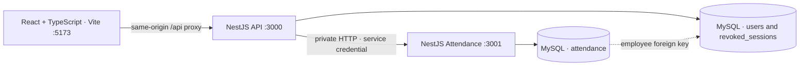

# Architecture

Implemented state, 7 November 2026.

## Runtime

One npm project contains `web/` and `server/`. The API and attendance service are independent Node processes with separate startup commands. Both bind to loopback. MySQL 8.4 runs through Docker Compose. The application uses parameterized SQL through `mysql2`. The migration runner owns schema changes and provisions dedicated runtime accounts.

The API owns authentication, account management, and browser permissions. It derives the actor from the signed session and supplies internal identity headers itself. The attendance service validates the private service credential and the role and owns attendance writes and photo normalization. The public API combines attendance metadata with current employee names in one batched account lookup.

## Storage

| Table | Responsibility and constraints |
| --- | --- |
| `users` | HR and employee identities, unique normalized email and employee code, salted password hash, active status, session version, and timestamps. Employees require a code. |
| `attendance` | Employee foreign key, Jakarta date, UTC submission instant, MIME type, size, and private image bytes. Unique employee/date prevents concurrent duplicates. Deleting a referenced employee is restricted. |
| `revoked_sessions` | SHA-256 digests of signed session tokens revoked at logout, with an expiry index. |
| `schema_migrations` | Applied migration versions. A MySQL advisory lock serializes migrations. Table creation and added-column checks support retries after interruption. |

The API runtime can access `users` and `revoked_sessions`. The attendance runtime can read and insert `attendance`. Its grants exclude attendance updates and deletes. A separate migration account has schema privileges.

Photo bytes and attendance metadata are inserted in one statement. Lists omit bytes. This avoids a separate file-write transaction in the assessment. Storing evidence in the database increases database and backup size as usage grows.

## Time and uploads

The attendance service captures one server instant after receiving a photo and before normalization. It stores UTC and derives the calendar date in Asia/Jakarta. The client displays WIB. One check-in is allowed per employee per Jakarta day.

Uploads accept one `photo` field, up to 2 MiB. Sharp decodes JPEG or PNG with a 16-megapixel limit, rejects unsupported or multi-page images, applies orientation, and re-encodes without the original metadata. Normalized output must also fit the size limit. Guards authorize requests before multipart processing.

A duplicate produces 409. An uncertain submission triggers a status refresh without automatic resubmission. If the date has changed, the UI directs the employee to HR to verify the earlier attempt.

## Sessions and permissions

Passwords use Node scrypt with random salts. Cookies are HttpOnly, SameSite=Lax, scoped to `/api`, and Secure when the configured public origin uses HTTPS. Signed tokens expire after two hours and have individual IDs. Protected requests check the signature, current role, account status, session version, and revocation digest.

Deactivation and reactivation increment the session version when status changes. Reactivation requires a fresh login. Logout revokes the individual token. A request already authorized and running may complete when account status changes.

Login routes check their fixed role. A deactivated employee receives the temporary-deactivation message after supplying correct credentials. Incorrect credentials receive the generic login error. Login throttling limits failed attempts, while successful logins release their allowance. This limiter is local to one API process.

Unsafe browser requests must match `PUBLIC_ORIGIN`. Evidence responses use `no-store` and `nosniff`. Internal service credentials stay in local environment configuration.

## Failure behavior

Internal calls have an eight-second response timeout. A refused connection produces 503 and a timeout produces 504. Employee management can operate while the attendance service is unavailable. Both processes expose readiness endpoints that check their own database table.

This repository supplies a local assessment runtime. Public deployment would need HTTPS termination, deployment configuration, appropriate operational logging, backups, and a shared rate limiter for multiple API instances.
